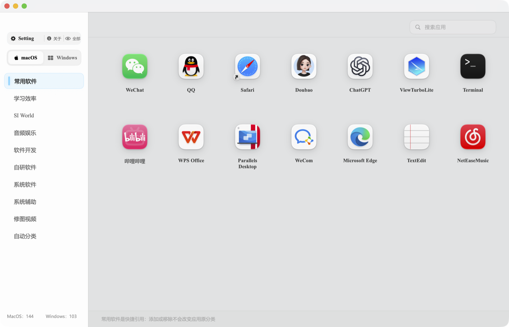
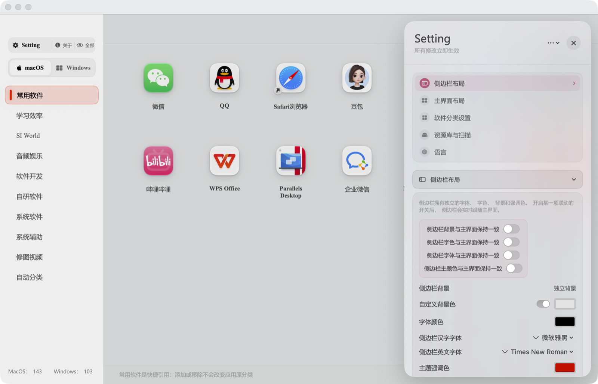
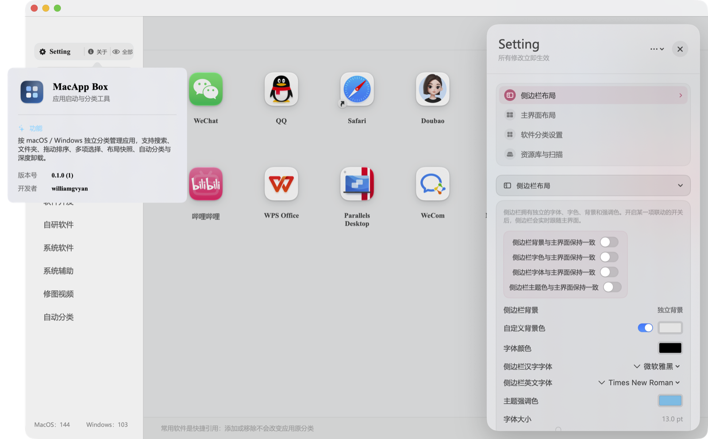
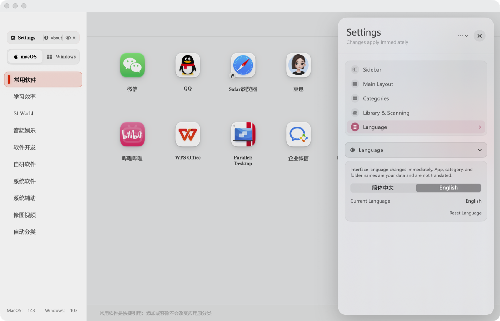
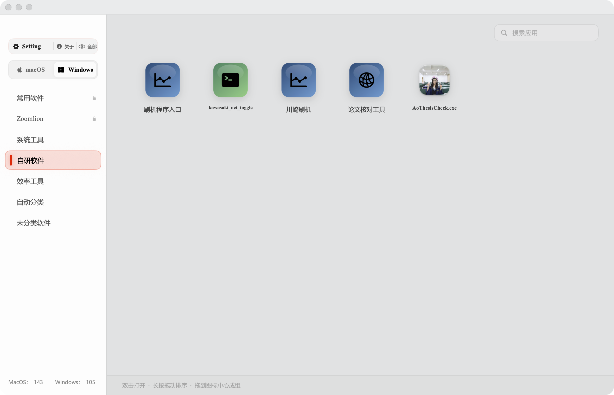

# MacApp Box

[](https://github.com/WilliamGvyan/MacAppBox/actions/workflows/build.yml)

一个面向 macOS 的应用启动器，按操作系统、类别和文件夹组织已安装应用。

## 实际运行截图











## 当前版本

- 原生 macOS 窗口，保留关闭、最小化、放大交通灯。
- 设置内提供简体中文与 English 实时切换；应用名和自定义分类名保持原样。
- 自动读取 `~/自研软件/程序库`，Mac 与 Windows 自研程序分别进入对应平台的“自研软件”分类。
- 右键选择“导入第三方软件…”可把 `.app`、`.exe` 或整个软件文件夹移入 `~/第三方软件/程序库`，Windows 程序通过 Parallels 启动。
- 点击 Dock 图标或重新打开 App 时会恢复主窗口；关闭窗口或后台扫描时都不会再出现“进程在但找不到窗口”。
- `macOS / Windows` 两级系统切换。
- macOS 与 Windows 各自保存独立的类别名称、顺序、锁定状态和应用归属；在一个系统改分类不会影响另一个系统。
- 当前 Windows 分类已按用户要求清空到只保留「常用推荐」和兜底「未分类软件」；macOS 分类未改动。
- macOS 应用来自系统应用目录；Windows 应用读取 Parallels 暴露的应用快捷壳。
- 自研软件清单中的 Windows `.exe` 会出现在 Windows 的「自研软件」分类中。
- 若 Windows 下暂时没有自研软件分类，`.exe` 会先留在「未分类软件」；手动新建名为「自研软件」的类别后会自动归入。
- Windows 系统组件、安装器和帮助程序默认过滤。
- 默认类别：常用推荐、学习效率、音频娱乐、软件开发、自研软件、系统软件、未分类软件。
- 未分类软件固定在最后，为空时自动隐藏。
- 类别可新增、重命名、锁定名称、上下拖动排序。
- 多选模式支持批量移入类别、建立文件夹或整组拖动归类。
- 应用支持长按拖动（默认 0.35 秒，可在设置中调至 0.2–0.8 秒）：拖动预览以图标中心跟随指针；拖到目标位置可排序，拖到另一应用图标中心会成组为文件夹。
- 应用右键提供“上移 / 下移”作为拖动之外的兜底。
- 文件夹本身可在分类内拖动或拖到其他分类；打开文件夹后，内部应用也能长按拖动排序，文件夹名称可在外部右键或内部铅笔按钮修改。
- 右键应用可打开“卸载并清理”：扫描应用本体、Application Support、Caches、Preferences、Containers、Group Containers、Logs、LaunchAgents、WebKit、HTTPStorages、Cookies、Saved Application State 等关联项，确认后统一移到废纸篓。
- 12 套主题、跟随系统明暗模式、中文和英文系统字体独立选择。
- 图标大小支持 25%–200%，窗口尺寸变化时网格自动重排。
- 背景提供 10 种实时效果：主题材质、毛玻璃、透明、壁纸、壁纸模糊、浅色玻璃、深色玻璃、主题渐变、纯色、图片。
- 壁纸与壁纸模糊支持使用当前系统桌面、手动选择图片，或打开 `/System/Library/Desktop Pictures` 系统壁纸文件夹；所选图片会复制到应用数据目录。
- 设置面板按可折叠的“外观 / 布局 / 分类 / 资料库”组织；主题和背景使用下拉选择，不再平铺。
- 字体选择分为“汉字字体 / 英文字体”，下拉菜单包含推荐字体与全部系统字体，并显示当前字体与双语预览。
- 字体颜色支持跟随系统或自定义颜色；字号不再手动设置，会根据窗口宽度、网格列宽和图标大小自动调整，并通过最小缩放与收紧排版容纳长名称。
- 常用推荐按本机启动次数排序，可关闭并清空记录。
- 布局支持保存快照、恢复上一布局、重置和经典布局。
- 自研软件没有有效图标时自动生成彩色 SF Symbol 图标。
- 启动时直接读取上次的应用清单与 64px 图标缓存，同时后台扫描更新；登录后会通过 LaunchAgent 隐藏扫描并在完成后自动退出。

## 自研软件位置

打包后的应用位于：

```text
~/自研软件/MacApp Box.app
```

源码保留在当前项目目录。应用已登记到 `~/Applications/自研软件.app`，不放入 `/Applications`。

## 运行

```bash
./script/build_and_run.sh
```

构建脚本会生成并安装到 `~/自研软件/MacApp Box.app`，同时完成 ad-hoc 签名。

只编译、不启动：

```bash
swift build
./script/verify_recommendations.sh
```

## 项目结构

```text
Sources/MacAppBox/
  App/        应用入口与窗口
  Models/     数据模型和设置枚举
  Services/   应用扫描与卸载
  Stores/     状态、布局、分类和启动记录
  Support/    AppKit/SwiftUI 桥接与视觉组件
  Views/      侧栏、主界面、文件夹和设置面板
Tests/        常用推荐逻辑验证
script/       构建、图标和 LaunchAgent 脚本
```

推送到 GitHub 后，GitHub Actions 会在 macOS 上执行 `swift build` 和推荐逻辑验证。

## 支持与反馈

社区版免费，可通过 [Issues](https://github.com/WilliamGvyan/MacAppBox/issues) 反馈 Bug，或在 [Discussions](https://github.com/WilliamGvyan/MacAppBox/discussions) 交流使用方式。付费支持与 Pro 增强版计划见 [SUPPORT.md](SUPPORT.md)。

## 仍待补充的系统级能力

- 全屏模式、分页浏览和屏幕选择。
- 全局快捷键、F4、触发角与触控板手势。
- 菜单栏图标、登录时启动、全屏时隐藏菜单栏和程序坞。
- 自定义扫描来源。
- 布局文件导入和导出（当前提供内部快照）。
- 更完整的壁纸模糊、玻璃材质和图标着色选项。
